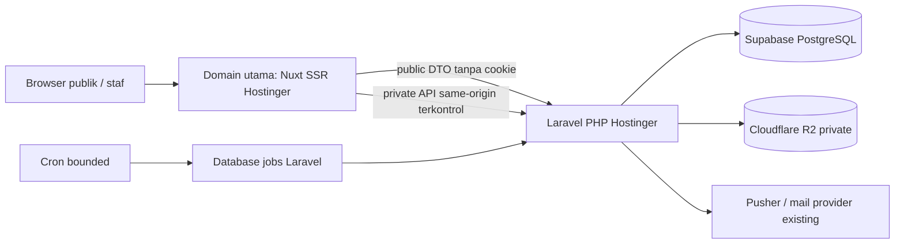

# Spesifikasi Hostinger shared + Supabase + R2

Status: baseline spesifikasi disetujui untuk implementasi. Status kode/bukti dan gate eksternal mengikuti [validation.md](validation.md); ini bukan klaim aktivasi produksi. Lihat [keputusan dan sumber](README.md). Semua ID HOST-* adalah requirement usulan.

## 1. Pemilihan paket berbasis bukti

Kandidat pertama adalah **Business Web Hosting atau SKU setara yang menyediakan Node.js Web Apps**. H-01 mencantumkan dukungan Nuxt pada Business/Cloud tertentu; nama dagang dapat berubah dan bukan alasan membeli paket sebelum verifikasi. Premium/shared yang hanya menjalankan PHP tidak memenuhi kebutuhan Nuxt SSR aplikasi ini.

| ID      | Kriteria wajib sebelum memilih/membayar                                                                              | Bukti yang diterima                                                             |
| ------- | -------------------------------------------------------------------------------------------------------------------- | ------------------------------------------------------------------------------- |
| HOST-01 | Dua deployment terpisah: Nuxt SSR dan Laravel PHP                                                                    | Konfirmasi SKU serta percobaan aplikasi pada domain staging                     |
| HOST-02 | Node cocok `apps/web/package.json`; pilih Node24 yang memenuhi batas minor                                           | Versi aktual dan build `npm ci`, `build:checked`, start/restart sukses          |
| HOST-03 | PHP sesuai lockfile dan Composer; GD/WebP, Fileinfo, mbstring, OpenSSL, PDO PostgreSQL dan ekstensi Laravel tersedia | CLI dan web memakai versi/ekstensi kompatibel; bukan screenshot versi PHP saja  |
| HOST-04 | Outbound HTTPS dan koneksi PostgreSQL Supabase diizinkan                                                             | DNS/TCP/TLS dan query/transaksi dari runtime PHP dengan rahasia disamarkan      |
| HOST-05 | Cron/scheduler dan pemroses queue bounded tersedia, dengan mekanisme overlap/restart                                 | Interval/timeout/quota nyata, heartbeat dan uji job setelah deploy              |
| HOST-06 | Routing same-origin, cookie Sanctum, upload dan CSP bekerja                                                          | Smoke dua role, CSRF, media dan error API lewat domain web                      |
| HOST-07 | Resource/node build limit, disk sementara, inode, CPU/RAM, bandwidth dan lokasi server sesuai beban                  | Inventaris SKU dan pengukuran staging; region diukur dari calon pembeli Bandung |
| HOST-08 | Biaya awal, renewal, periode kontrak, domain, backup serta add-on dipisahkan                                         | Penawaran aktual dan persetujuan pembelian pemilik, bukan angka perkiraan       |

Jika salah satu syarat wajib gagal: hentikan cutover, simpan deployment existing, dan laporkan blocker. Jangan mengubah SSR menjadi static-only, database menjadi MySQL, membuka R2, atau mengganti paket ke VPS tanpa keputusan baru pengguna. Dokumen ini belum menyatakan suatu paket pasti cocok.

## 2. Topologi dan routing

- HOST-09: Node web dan PHP berada pada deployment/site terpisah. Backend dapat memakai subdomain teknis HTTPS, tetapi browser staf tetap lewat domain web. Origin backend disimpan pada konfigurasi server, tidak dapat dipilih query/payload pengguna.
- HOST-10: Handler publik Nuxt existing tetap memvalidasi allowlist. Route auth, CSRF dan internal yang dibutuhkan diteruskan eksplisit ke Laravel; jangan membuat wildcard open proxy atau menimpa handler publik existing.
- HOST-11: Matriks method+path di bawah berasal dari `apps/api/routes/api.php`, `routes/web.php`, Sanctum dan handler Nuxt existing. Pertahankan handler BFF publik yang sudah memvalidasi/sign request; jangan menggantinya dengan proxy buta. Route di luar kontrak tidak diteruskan otomatis; path/ID/variant/query/body mengikuti validator kontrak masing-masing.
- HOST-12: Ganti ketergantungan `VERCEL === '1'` dengan konfigurasi deployment yang eksplisit setelah desain disetujui. Host, forwarded headers, trusted proxy dan tanda tangan request harus diuji pada Hostinger; jangan memercayai header IP dari browser.
- HOST-13: Cookie auth Secure/HttpOnly/SameSite sesuai SRS. Buktikan host-only/domain cookie, CSRF, logout, expired/inactive session, role404/403 dan JSON422 lewat domain utama. Subdomain backend bukan cara melewati pemeriksaan sesi.
- HOST-14: Laravel hanya mengekspos direktori `public`; `.env`, storage, log, source, vendor, backup dan CA privat tidak berada dalam document root. Source build Node dan secret berada di luar public output.

### Matriks route HOST-11

| Method dan path pada domain web                                                                                                                                                                                                              | Pemilik/tujuan                                               | Batas akses                                                                               |
| -------------------------------------------------------------------------------------------------------------------------------------------------------------------------------------------------------------------------------------------- | ------------------------------------------------------------ | ----------------------------------------------------------------------------------------- |
| GET/HEAD halaman publik, auth UI, backoffice UI, robots dan sitemap XML                                                                                                                                                                      | Nuxt                                                         | Halaman tim/auth tetap noindex/no-store; UI bukan otorisasi API                           |
| GET/HEAD `/api/v1/content`, `/api/v1/content/{id}/logo`, `/api/v1/compare`, `/api/v1/sitemap`, `/api/v1/properties`, `/api/v1/properties/{slug}`                                                                                             | Handler BFF publik Nuxt→Laravel public route yang ekuivalen  | Public DTO/signature/allowlist existing; SSR tidak meneruskan cookie staf                 |
| POST `/api/v1/analytics`                                                                                                                                                                                                                     | Relay stateless Nuxt→Laravel analytics                       | Strict body, no credentials, throttle, feature flag existing                              |
| POST `/api/csp-report`                                                                                                                                                                                                                       | Handler lokal Nitro                                          | Bukan proxy Laravel; parser/size/rate/redaction existing                                  |
| GET `/sanctum/csrf-cookie`; POST `/auth/login`, `/auth/logout`, `/auth/forgot-password`, `/auth/reset-password`                                                                                                                              | Laravel via same-origin bridge                               | Cookie/CSRF/session/recovery/rate-limit sesuai kontrak; logout authenticated              |
| GET/PATCH `/api/v1/me`; GET `/api/v1/realtime`; POST `/api/v1/realtime/auth`                                                                                                                                                                 | Laravel via authenticated bridge                             | Active session, scoped private channel dan CSRF mutation                                  |
| GET/POST `/api/v1/internal/users`; PATCH `/api/v1/internal/users/{id}`; GET `/api/v1/internal/audit`, `/api/v1/internal/reports`, `/api/v1/internal/privacy`, `/api/v1/internal/operations`                                                  | Laravel internal                                             | Policy role/active dan version/CSRF sesuai route; tidak melepas prefix pada implementasi  |
| GET/POST `/api/v1/internal/content`; PATCH `/api/v1/internal/content/{id}`; POST `/api/v1/internal/content/{id}/logo`                                                                                                                        | Laravel internal CMS                                         | Admin policy, validation, upload limits, version/audit                                    |
| GET/POST `/api/v1/internal/properties`; GET/PATCH `/api/v1/internal/properties/{id}`; PATCH `/api/v1/internal/properties/{id}/location`, `/api/v1/internal/properties/{id}/commercial`; POST `/api/v1/internal/properties/{id}/owner`        | Laravel internal katalog                                     | Ownership/Admin policy dan concurrency existing                                           |
| GET/POST `/api/v1/internal/properties/{id}/media`; POST `/api/v1/internal/properties/{id}/media/process`; PATCH `/api/v1/internal/properties/{id}/media/{mediaId}`; GET `/api/v1/internal/media/{mediaId}/{variant}`                         | Laravel internal media                                       | Session+policy; variant640/1280/1920/download; no public caching                          |
| GET/POST `/api/v1/leads`; GET `/api/v1/leads/summary`, `/api/v1/leads/{id}`, `/api/v1/leads/{id}/history`; PATCH `/api/v1/leads/{id}/contact`, `/api/v1/leads/{id}/status`; POST `/api/v1/leads/{id}/assignment`, `/api/v1/leads/{id}/notes` | Laravel CRM                                                  | Admin/assignee scopes, version/CSRF dan atomic history/notifikasi existing                |
| GET `/api/v1/notifications`; PATCH `/api/v1/notifications/{id}/read`                                                                                                                                                                         | Laravel inbox                                                | Recipient-scoped authenticated access                                                     |
| GET/HEAD `/media/{mediaId}/{variant}`                                                                                                                                                                                                        | Laravel public file handler                                  | Publication/READY/revocation; variant640/1280/1920/download                               |
| GET/HEAD `/up`, `/ready`                                                                                                                                                                                                                     | Laravel health via controlled bridge                         | Respons minimal/throttle; tidak mengungkap environment atau secret                        |
| GET `/api/v1/inquiries/options`; POST `/api/v1/inquiries` dan internal inquiry/qualification/visits/akad routes yang diusulkan                                                                                                               | BFF stateless untuk intake; Laravel protected untuk internal | **Belum existing**; hanya ditambah bersama implementasi kontrak pada measurement-crm-spec |

Saat implementasi, hasilkan/cek daftar route method+path lengkap dari router aplikasi dan uji setiap kelas di atas; GET/HEAD alias harus disesuaikan dukungan router. Unknown method/path ditolak405/404 sesuai kontrak, termasuk encoded path traversal, URL origin arbitrer dan proxy headers yang tidak sah. Kebijakan ini mencakup navigasi browser, hydration fetch, SSR server fetch, recovery dan realtime sekaligus.

## 3. Supabase dan data persisten

- HOST-15: Pertahankan project/database produksi existing. Tidak menjalankan seed, pembersihan katalog, dump ke Git, atau reset schema ketika deploy.
- HOST-16: Pilih endpoint dari dashboard yang sah; jangan menebak hostname. Uji kemampuan IPv6/IPv4 Hostinger. Session pooler menjadi kandidat untuk IPv4 dan prepared statements; transaction pooler hanya dipakai setelah kompatibilitas driver/session state dibuktikan. DB-01 menjadi referensi, bukan akses yang telah dilakukan.
- HOST-17: TLS `verify-full` dengan CA yang sesuai dan hostname yang benar. Gagal verifikasi menyebabkan koneksi ditolak; tidak menurunkan mode TLS untuk membuat smoke lulus. Tidak menaruh password/URL koneksi dalam output, artefak PR atau browser.
- HOST-18: Batasi koneksi PHP/queue, query dan timeout menurut kapasitas Supabase aktual. Uji concurrent intake, lock, retry dan transaksi; monitor connection saturation. Browser tidak memperoleh kredensial DB atau service-role key.
- HOST-19: Queue/cache/session database tetap memakai koneksi aplikasi yang memenuhi transaksi existing. Jangan memindahkan penulisan notifikasi/history ke koneksi nontransaksional.
- HOST-20: Pertahankan recovery akun dan email pengiriman yang telah dipilih; buktikan dari Hostinger. Pindah hosting tidak boleh menghilangkan reset password atau menciptakan akun demo.

## 4. Media R2 dan keterbatasan shared

- HOST-21: Pertahankan bucket private dan pemeriksaan READY+published+property publication pada handler. Dilarang mengaktifkan public domain untuk bucket existing sebagai jalan pintas optimasi. R2-01 menjelaskan bahwa public access mengubah batas akses.
- HOST-22: Request media dan OG image stabil, dapat diakses crawler ketika published, dan segera ditolak ketika unpublished. Origin raw/source tidak keluar ke publik. Cache/purge dan URL versioning harus menjaga revocation; baseline gunakan handler existing sampai strategi cache dibuktikan.
- HOST-23: Uji upload multipart, temporary disk, GD/WebP, waktu proses, max body dan varian640/1280/1920. Deploy baru tidak menghapus media/journal/storage yang diperlukan.
- HOST-24: PDF harus tetap mengikuti scanner fail-closed existing. Jika executable scanner/service tidak tersedia di shared, upload PDF baru tetap ditolak; jangan mematikan scanner. Solusi scanner terpisah memerlukan spesifikasi biaya dan persetujuan berikutnya.

## 5. Queue dan scheduler: keputusan yang belum selesai

Requirement existing menarget push p95≤5 detik, sedangkan kemampuan proses persisten/cron pada shared belum diverifikasi. Ini **konflik yang harus ditutup sebelum produksi**, bukan pengecualian otomatis karena pengguna memilih shared.

| Opsi                              | Kondisi                                                            | Konsekuensi                                                                                                  |
| --------------------------------- | ------------------------------------------------------------------ | ------------------------------------------------------------------------------------------------------------ |
| A: proses persisten didukung SKU  | Tersedia process supervision/restart yang dibuktikan               | Pertahankan target p95≤5 detik dan uji load                                                                  |
| B: cron bounded                   | Interval minimal, overlap lock dan timeout sesuai hosting terbukti | Usulan target dequeue p95≤120 detik pada beban uji; bukan real-time≤5 detik; perlu persetujuan perubahan SRS |
| C: shared tidak memenuhi keduanya | Media/notification jobs tidak reliabel                             | Cutover diblokir; minta keputusan arsitektur baru, jangan membeli layanan lain otomatis                      |

HOST-25: Satu scheduler/worker aktif per queue; gunakan lock durable, batch/time limit di bawah timeout host, retry/backoff dan failed_jobs existing. Hindari proses tidak terbatas pada HTTP request, enqueue sebelum commit, duplikasi scheduler lama/baru, atau perintah berisi secret.

HOST-26: Pisahkan antrian notifikasi yang ringan dari media jika batch media menghambat follow-up. Tidak menambah Redis atau layanan queue tanpa bukti. Ukur enqueue-to-persisted inbox, enqueue-to-push, oldest-job-age dan error per jenis; polling inbox tetap tersedia saat provider gagal.

## 6. Konfigurasi, release dan observability

- HOST-27: Inventaris environment berdasarkan `.env.example` existing; semua nilai privat lewat secret storage proyek. Public config hanya origin publik, kontak publik dan ID tag publik yang diperlukan. Staging memakai kredensial/dataset terpisah dan noindex+auth.
- HOST-28: Build checked dilakukan lokal/host build yang mendukungnya, tanpa GitHub Actions. Hasil PHP dan Nuxt terikat satu release manifest/SHA; jangan mempromosikan frontend yang memerlukan API baru sebelum API tersedia.
- HOST-29: Adopsi release folder/platform milik masing-masing site. Node build output yang ditimpa deploy tidak digunakan untuk backup, upload atau state aplikasi; H-01 menjelaskan build/release dikelola platform. Rencana Laravel harus memisahkan shared storage dari release code.
- HOST-30: Monitoring minimal uptime halaman publik, `/up`/readiness, error5xx, SSR/API p95, 429 legitimate/crawler, queue lag, failed_jobs, disk/temp, email failure, DB connections dan formulir gagal. Log memakai request ID, tanpa isi form, telepon, token atau query mentah.
- HOST-31: Cache immutable untuk aset berhash. Auth, CRM, consent response dan intake POST `no-store`; HTML yang berisi nonce/user-state tidak boleh diberi cache publik sembarang. Harga bertanggal harus berubah sesuai WIB; jangan menyajikan promo expired melalui cache.
- HOST-32: Baseline PRD tetap availability99,5%, API p95≤500 ms, SSR p95≤1,5 s, error<1%; ukuran dataset20 request/s pada PRD adalah acceptance existing, bukan perkiraan traffic bulan pertama. Ketidakmampuan paket membuktikannya dicatat untuk keputusan scope/SLO, bukan diklaim lulus.

## 7. Cutover dan rollback

1. Inventaris domain final, DNS saat ini, URL lama, email/DNS yang harus dipertahankan, serta release existing yang masih dapat digunakan. Domain belum diputuskan.
2. Backup DB konsisten dan inventaris refs/media; uji restore di lingkungan terisolasi. Target existing RPO≤24 jam/RTO≤8 jam, retensi backup mengikuti kebijakan proyek.
3. Deploy staging dengan DB/media terisolasi atau fixture; akun staging tidak mempunyai akses tulis produksi. Jalankan matriks [verifikasi](delivery-verification.md).
4. Tutup gap runtime/routing/worker; sahkan privasi, formulir, harga, domain dan strategi URL. Saat domain berubah, gunakan mapping satu-ke-satu, canonical/sitemap baru, dan redirect permanen sesuai G-01. Pindah host tanpa URL berubah tidak memerlukan Change of Address.
5. Saat jadwal cutover disetujui: hentikan worker/scheduler lama sebelum mengaktifkan yang baru; pastikan tidak ada dua writer migrasi. DB dan R2 tetap sumber yang sama, tidak diduplikasi.
6. Setelah DNS/cutover: uji HTTP/canonical/consent/login/lead/media, pantau error dan queue. Simpan deployment lama selama jendela rollback usulan 7 hari; redirect SEO dipertahankan lebih lama sesuai rencana migrasi domain.
7. Rollback code/routing/DNS ke release tervalidasi bila auth/intake gagal, media bocor, error tinggi atau jobs tersangkut. Aktifkan hanya scheduler tujuan rollback. Jangan restore seluruh DB di atas lead baru yang sah; gunakan schema aditif kompatibel dan rekonsiliasi intake/event yang diterima.
8. DNS rollback bergantung TTL/cache dan tidak instan. Jangan menghapus origin lama, R2 objects, DNS mail atau project Supabase sebagai bagian cutover.

Keluaran keputusan hosting: SKU yang lolos dengan bukti, biaya aktual, diagram route final, opsi queue yang disetujui, hasil restore dan daftar batas. Tanpa keluaran itu deployment Hostinger tetap **BELUM SIAP**.
